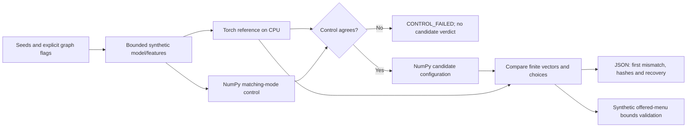

# Diagnose a serving graph before trusting its choices

The existing model-demo establishes the mechanism on a fixed fixture. This diagnostic exposes
the actual scores, first mismatching row/option, configured masks/relations and input/weight hashes
so a researcher can inspect a disagreement and recover on the same data. It runs the repository's
existing hand-written NumPy forward against its independently executed Torch reference.

The weights are **SYNTHETIC**, randomly initialized; the rows are **SYNTHETIC encoded features**.
No model is trained, no game is played and no option is certified legal by a game engine.
This is a reproducible numerical-mechanics tool, not competition-agent reproduction.

## Setup and a normal example

Use an existing Python environment with NumPy and CPU Torch. The tested environment records
Python3.11.15, NumPy2.4.6 and Torch2.13.0; no local dependency installation was needed.
If preparing your own environment, the new CI workflow declares the same dependency versions
and uses the official CPU Torch package index. Nothing here requires a GPU or engine installation.

```bash
PTCG_PYTHON=/path/to/python-with-numpy-and-torch
"$PTCG_PYTHON" demo/serving_diagnostic.py --boards 8 --seed 0 \
  --reference-mode masked --serving-mode masked
```

Output is JSON with schema `ptcg-serving-diagnostic/v1`; this command exits0 with `result=PASS`.
On the recorded fixture the maximum score error is8.26014e-8 and choices agree on all8rows.
Those are differential correctness witnesses, not speed/playing-strength measurements.

## Expose a discrepancy, then recover

```bash
"$PTCG_PYTHON" demo/serving_diagnostic.py --boards 8 --seed 0 \
  --reference-mode masked --serving-mode unmasked
# exit1, result=MISMATCH; matching-mode control still PASS
```

The first mismatch is row0, option1; aggregate maximum score error is0.0339153 on this fixture.
All8argmax choices still agree. A choice-only check would miss the changed function; the score
criterion catches it. The report includes both vectors and the exact input/weight/source hashes.
Changing only `--serving-mode masked` recovers PASS while preserving input/weight hashes.

Explore `no-state-mask`, `no-option-mask` or `no-relations` to isolate one configuration change.
All three produce score discrepancies on the same declared witness. Change `--seed` or
`--boards` within1..64 to explore another fixture; the report labels and fingerprints those inputs.

```bash
"$PTCG_PYTHON" demo/serving_diagnostic.py --boards 8 \
  --reference-mode unmasked --serving-mode unmasked
```

This also passes agreement, while `historical_training_verified=false` remains visible. Matching
a configured reference does not prove it reconstructs an old training run. The historical
manifest, weights and package are still necessary for the existing packaging/parity gates.
This diagnostic does not replace their reference-noise, provenance or serving-stamp checks.

## Data flow and failure handling



Finite vectors and matching row/option counts are required. The existing demo criterion remains
maximum absolute error strictly below1e-4 **and** zero choice disagreements. An empty comparison,
NaN/Infinity or malformed vector is an error, never a passing result. Invalid budgets/modes/seeds
exit2 before inference. Import failures name the dependency problem and suggest `PTCG_PYTHON`.
Numerical mismatch or failed matching-mode control exits1; successful agreement exits0.

Each row's `menu_choice_valid` checks only the synthetic offered-token menu's bounds via the
existing decision validator. It does not check card semantics, combined-choice legality or state
transitions. The helper restores changed reference globals after success/error and uses a CPU
RNG context. Construction explicitly selects CPU/float32 and restores the caller's dtype/device
context; the regression witness uses a meta device, without accelerator allocation. Run diagnostics
in separate CLI processes: the API temporarily changes collator globals and is not intended for
concurrent calls in one process. It writes no model, input, training run or engine artifact.

## Checks, contribution and learning

```bash
python3 -m unittest discover -s demo/tests -p test_serving_contract.py
"$PTCG_PYTHON" -m unittest discover -s demo/tests_numeric
PTCG_PYTHON="$PTCG_PYTHON" bash scripts/check.sh
```

The additional workflow `.github/workflows/serving-diagnostic.yml` runs the numerical command
and normal diagnostic on CPU; the original CI/check scripts are unchanged. Remote CI for this
unpublished successor is **NOT_RUN**. [Recorded bounded witnesses](serving-diagnostic-eval.json)
include all5serving modes on identical inputs/weights, a64-row boundary and same-unmasked
reference control. They contain no optimization or performance claim.

Original contribution: a reusable comparison/report layer around existing project kernels,
matching-mode control, first-discrepancy diagnosis, deterministic fingerprints, CLI recovery and
decision-menu validation. Existing team-owned Torch/NumPy implementation keeps its attribution
and licensing; the wrapper/tests/docs are Oscar's original MIT tooling. Competition rank, GPU
prototype scope and missing BEST1_fixed artifacts are unchanged.

Candidate learning, supported by this fixture: identical choices can hide different logits;
an explicit reference is essential; and a failed positive control invalidates the evaluator's
candidate verdict. These are engineering lessons, not measured effects on historical ladder scores.
No real-engine, trained-model, corpus, training/GPU job or public release was verified here.

The harness route result is SHADOW with unverified runtime boundaries and dispatch disabled;
it is [routing evidence](serving-diagnostic-routing.json), not an independent review or release
approval. Execution/self-check stay in this owner chat. [Independent root acceptance](serving-diagnostic-root-acceptance.json)
is separately recorded for source `bdaf344`; it covers the bounded synthetic CPU diagnostic only.
